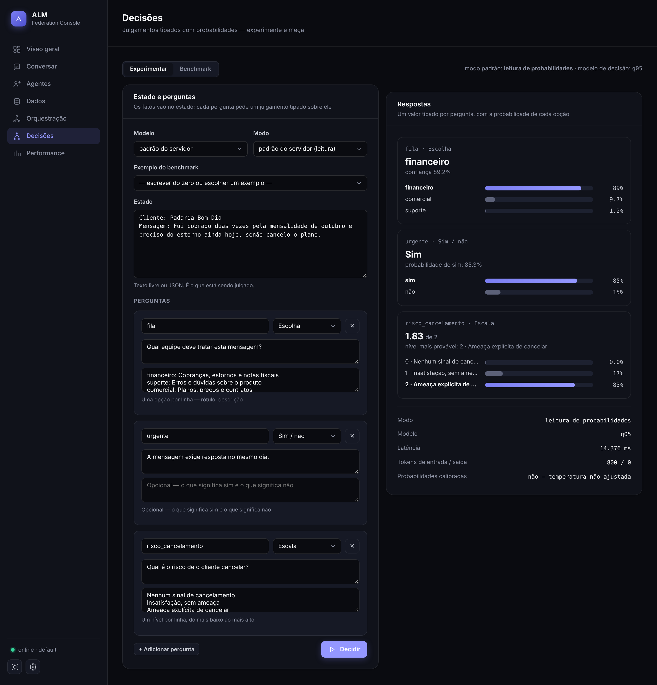
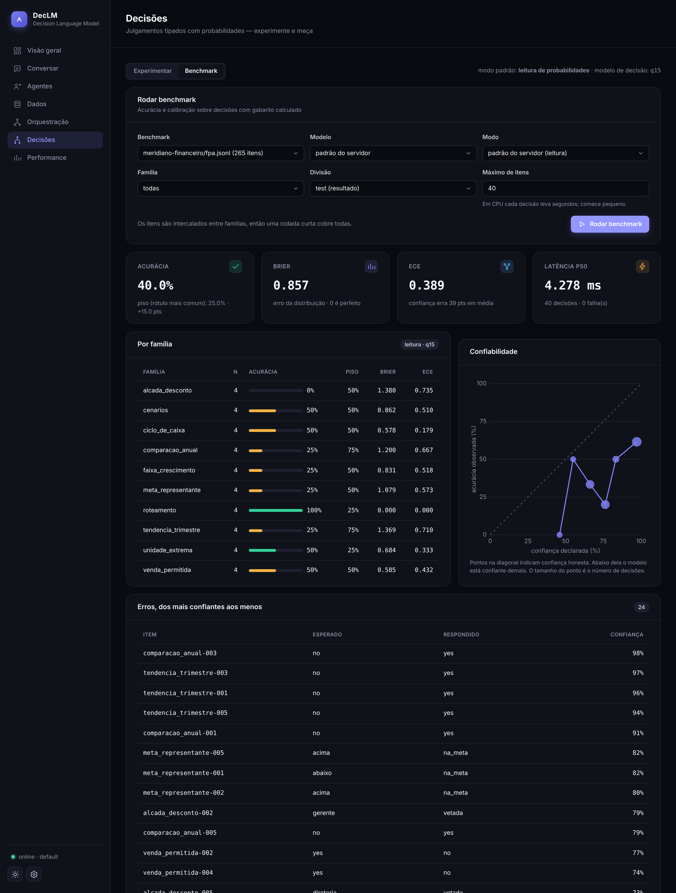

<h1 align="center">DecLM</h1>
<p align="center"><strong>Decision Language Model</strong></p>

<h3 align="center">Stop asking LLMs for JSON. Ask for a decision.</h3>

<p align="center">
  Open-source <strong>decision models</strong>: typed questions in — <em>which one? how much? is it true?</em> —<br>
  probabilities out. One forward pass, zero generated tokens, on your own hardware.
</p>

<p align="center">
  <a href="#-60-second-start">Quick start</a> •
  <a href="#-same-model-same-questions">The numbers</a> •
  <a href="#-how-it-works">How it works</a> •
  <a href="#-a-benchmark-no-model-graded">Benchmark</a> •
  <a href="#-where-it-stands">Status</a> •
  <a href="#-the-federation-around-it">The federation</a>
</p>

<p align="center">
  <a href="https://opensource.org/licenses/MIT"></a>
  <a href="https://www.python.org/downloads/"></a>
  
  
</p>

> 🇧🇷 [Leia em português](README.pt-BR.md)

<p align="center">
  
</p>

---

## The problem with asking a chatbot to decide

Most of what an agent system asks a model is not prose. It is a **decision your code consumes**:
which queue, which tool, is this allowed, who approves, how severe. Today that looks like this:

```python
reply = llm("Classify this ticket. Answer in JSON, with a confidence from 0 to 1...")
data = json.loads(reply)        # works, most of the time
data["confidence"]              # a number the model made up
```

You pay for every output token, you wait for them one by one, and the confidence means nothing.

The model already *knew* the answer before it wrote a single character — as a probability over its
next token. DecLM reads it there:

```python
from alm.decision import Choice, DecisionEngine, DecisionRequest, Noul, Score

result = await engine.decide(DecisionRequest(
    state="Charged twice for October. Refund me today or I cancel my plan.",
    questions={
        "queue": Choice(instructions="Which team handles this?",
                        options={"billing": "charges and refunds",
                                 "support": "product issues",
                                 "sales": "plans and contracts"}),
        "cancel_threat": Noul(instructions="The customer is threatening to cancel."),
        "churn_risk": Score(instructions="How likely is the customer to cancel?",
                            levels=["no sign", "unhappy", "explicit threat"]),
    },
))

result.choice("queue").probabilities     # {'billing': 0.9999, 'support': 0.00003, 'sales': 0.00004}
result.noul("cancel_threat").probability # 0.9956
result.score("churn_risk").probabilities # [0.0, 0.0038, 0.9962]
result.completion_tokens                 # 0
```

That output is real: Qwen2.5-1.5B, no training, on a CPU. Three questions, one call, no text
generated — and a number you can put a threshold on: auto-approve above 0.95, send the rest to a
person.

## 📊 Same model, same questions

Only the way of asking changed.

| | Ask for JSON | Read the decision |
|---|---|---|
| **Accuracy** | 48.6% | **63.9%** |
| **Time per decision** | 10.2 s | **3.7 s** |
| **Output tokens** | paid for | **0** |
| **Probability for every option** | no | **yes** |
| Routing questions answered correctly | 0 of 12 | 6 of 12 |

<sub>Qwen2.5-1.5B-Instruct, untrained, 4 CPU cores, the 72 public "original" items of
<a href="https://github.com/fstandhartinger/jevbench">JevBench</a>, one run each. Skipping the
order-debiasing step takes readout to 1.4 s at 62.5%. It is a small sample on a small model — the
point is that you can <a href="#-a-benchmark-no-model-graded">rerun it yourself</a> in minutes.</sub>

## ⚡ 60-second start

No API key. No GPU required to try it.

```bash
git clone https://github.com/ceschmiedel/ALM.git && cd ALM
pip install -e ".[local]"                # Python ≥ 3.11
declm init
declm model add decider --tier slm --backend transformers --model Qwen/Qwen2.5-1.5B-Instruct
ALM_DECISION_BACKEND=readout ALM_DECISION_MODEL=decider declm serve
```

<sub>CPU only? Add <code>--param device=cpu --param dtype=float32</code> to the <code>model add</code> line.</sub>

Open **http://localhost:8800/ui/#/decisions** and play — or call it:

```bash
curl -s localhost:8800/v1/systemone -H 'content-type: application/json' -d '{
  "state": "Charged twice for October. Refund me today or I cancel my plan.",
  "questions": {
    "queue":         {"type": "choice", "instructions": "Which team handles this?",
                      "criteria": {"billing": "charges and refunds", "support": "product issues"}},
    "cancel_threat": {"type": "noul",   "instructions": "The customer is threatening to cancel."},
    "churn_risk":    {"type": "score",  "instructions": "How likely is the customer to cancel?",
                      "criteria": ["no sign", "unhappy", "explicit threat"]}
  }
}'
```

`/v1/systemone` is the request shape hosted decision models already speak, so SDKs and benchmarks
written for it can point at your own server.

## 🧩 Three questions are enough

| Primitive | Asks | You get |
|---|---|---|
| **Choice** | Which option? | The label, and the probability of each option |
| **Score** | Where on an ordered scale? | The expected level, and the probability of each level |
| **Noul** | Is this true? | The probability of "yes" |

Routing, guardrails, approval ladders, eligibility rules, triage, rubric grading, reranking —
they all decompose into these three. Several questions about the same state go out in one call.

## 🔬 How it works

```
 state + question ──►  A. billing   B. support   C. sales  ──►  one forward pass
                                                                      │
                          P(next token = "A"), P("B"), P("C")  ◄──────┘
                                        │
              shown in several orders, averaged   →  position bias cancels
                                        │
                     temperature per question type →  calibrated probabilities
```

- **Readout.** Options sit behind single-token labels. The model runs once and the probability
  of each label is read from the next-token distribution. Nothing is generated, so nothing is parsed.
- **Order debiasing.** Small models favour whatever is listed first. Each choice is shown in
  several cyclic shifts and the log-probabilities are averaged, which cancels a position bias that
  is additive in logit space. On a 0.5B model this alone took choice accuracy from 33% to 47%.
- **Calibration you can measure.** One temperature per question type, fitted on labelled data,
  and a benchmark that reports Brier and ECE next to accuracy.
- **A fallback that always works.** A model that hides its logits — Claude, GPT, anything behind
  a chat-only API — is asked for JSON instead, through the same contract. You lose the
  distribution, not the feature.

| Where the model runs | Readout | Notes |
|---|---|---|
| In process, `transformers` (any open model, LoRA adapters included) | ✅ exact | The path used for every number on this page |
| vLLM / OpenAI-compatible server with `logprobs` | ✅ top 20 | Implemented; tested against stubbed responses only |
| Hugging Face Inference Providers | JSON only | 13 Qwen model/provider pairs probed: none returned `logprobs` |
| Claude, Gemini, Ollama | JSON only | Their APIs expose no token probabilities |

## 🏁 A benchmark no model graded

Most decision benchmarks are labelled by a bigger model, so a score measures agreement with that
model. This one ships in the repo and every expected answer is **computed from a spreadsheet**:
265 decisions in Brazilian Portuguese over a three-statement financial model — approval ladders,
discount policies, growth bands, target attainment, cash cycle, routing. Families are balanced, so
always answering the commonest label scores 20%.

```bash
declm decide bench packs/meridiano-financeiro/decisions/fpa.jsonl --split test --model decider --backend readout
```

| Model, no training | Runs on | Mode | Accuracy | Brier | ECE |
|---|---|---|---|---|---|
| Qwen2.5 0.5B | 4-core CPU | readout | 42.3% | 0.706 | 0.163 |
| Qwen2.5 1.5B | 4-core CPU | readout | 46.9% | 0.756 | 0.334 |
| Qwen3.5 9B | Hugging Face | JSON | 76.3% | — | — |
| Qwen2.5 72B | Hugging Face | JSON | **83.5%** | — | — |

<sub>Test split, 194 items, one run each. Per-family numbers and caveats:
<a href="packs/meridiano-financeiro/README.md#benchmark-de-decisões">pack README</a>.</sub>

Three things this table says out loud:

1. **Small untrained models route but do not calculate.** Under 2B, anything with a numeric rule
   sits at chance. That gap is what a trained decision model has to close.
2. **One family beats every model, including the 72B.** Cash-conversion cycle — add two numbers,
   subtract a third, compare — scores 47% across the board, below its own 53% floor. Decide in the
   model, compute in code.
3. **Hosted models cannot be calibrated.** No probabilities, no Brier, no ECE.

**Beat the baseline.** Run it on your model and open a PR with the numbers.

<p align="center">
  
</p>

## 🚦 Where it stands

Honest status, because a README is not a benchmark.

| | |
|---|---|
| ✅ | Decision contract — Choice, Score, Noul — with readout and JSON backends |
| ✅ | `POST /v1/systemone`, order debiasing, per-type temperature |
| ✅ | `declm decide bench` — accuracy, Brier, ECE, reliability curve |
| ✅ | A Portuguese benchmark with computed answers |
| ✅ | `declm decide dataset build` — training data from licence-classified public sources and rule-based generators, **no model-labelled data** |
| ✅ | A console screen to try decisions and run benchmarks |
| 🚧 | **The trained decision adapter.** Everything above runs on *untrained* open models. A LoRA on a small model, trained on the data pipeline and judged by the benchmark, is the next step — it needs a GPU, and help is welcome |
| 🗺️ | Prefix caching, so many questions share one pass over the state |

If you have a GPU and want to train the first open Portuguese decision model, the data, the
benchmark and the serving path are already here. See [docs/decisions.md](docs/decisions.md).

<sub>The readout technique follows the open decision-model projects, notably
<a href="https://github.com/nokia-applied-research/AnyJev">AnyJev</a> and
<a href="https://github.com/jaredpalmer/kev">Kev</a> (both Apache-2.0); the implementation here is
DecLM's own. DecLM is not affiliated with any hosted decision-model vendor.</sub>

---

# 🌐 The federation around it

Decisions are the smallest unit. DecLM is also the system that runs on them: a governed federation of domain experts, each with its own small model, orchestrated
by a Context Graph. Its router, its arbiter, its graders and its access policy are all typed
decisions, which is why the decision model exists.

## 🧭 Why a federation

The dominant agent architecture puts one frontier LLM at the centre: every agent calls the same
model, varying only the prompt. It works, and it hits four structural limits in regulated,
high-volume enterprise settings — aggregate token cost, external latency and single points of
failure, data residency, and generic behaviour that never internalises a client's ontology.

**DecLM's thesis:** in a domain, a well-routed federation of specialists beats a generalist — but
that superiority is *not automatic*. It depends almost entirely on the quality of the context and
routing layers, not on the individual models. So this project invests where the leverage is:

| The models | The orchestration |
|---|---|
| Replaceable | Where the value accumulates |
| A LoRA adapter, an SLM, an API | The Context Graph that routes them, the memory that connects them, the governance that makes them auditable |

DecLM does not replace the LLM. It repositions it: from omnipresent executor to occasional
orchestrator and teacher of the domain models. Where sovereignty, latency and volume matter,
the local specialist takes over; where open-ended reasoning is essential, the LLM stays in the loop.

**The fallback to the LLM is by design, not a failure.** It guarantees the federation is never
worse than the monolithic baseline: in the worst case it hands the task back to the LLM. In the
common case it answers locally, cheaply, and inside the client's perimeter.

---

## 🏗️ Architecture

Five functional layers plus two cross-cutting ones. Each maps to a Python package.

```
                    ┌──────────────────────────────────────────┐
   intent  ───────► │ L1  Interface & ingestion      alm.protocol
                    │     Liquid Interface Protocol (LIP)      │
                    └───────────────────┬──────────────────────┘
                                        ▼
                    ┌──────────────────────────────────────────┐
                    │ L2  Cognitive router           alm.router │
                    │     classify · decompose · match · confidence
                    └───────────────────┬──────────────────────┘
                                        ▼
                    ┌──────────────────────────────────────────┐
                    │ L4  Dependency orchestration   alm.orchestration
                    │     plan ──► DAG · parallel where independent
                    └───────────────────┬──────────────────────┘
                                        ▼
                    ┌──────────────────────────────────────────┐
                    │ L3  Expert federation          alm.experts
                    │     own model (DecLM) + own retrieval (CMRAG)
                    └───────────────────┬──────────────────────┘
                                        ▼
                    ┌──────────────────────────────────────────┐
                    │ L5  Arbitration & synthesis    alm.arbitration
                    │     verifier · confidence · authority · judge
                    └───────────────────┬──────────────────────┘
                                        ▼
                                    answer + full provenance trace

   CX  Context & memory   alm.graph + alm.cmrag   ── feeds routing, execution, synthesis
   GV  Governance (IBAC)  alm.governance          ── no context access happens outside it
```

### What is actually new here

Mixture-of-Experts is not new; the difference is **where the routing lives**. Inside an MoE LLM
the router is internal, implicit, learned and unauditable. In DecLM the routing is **external,
explicit and governable**: the Context Graph decides which expert is engaged, in what order, and
how the results are combined — and it records why.

That makes explicit what a monolith does implicitly. It is simultaneously the largest engineering
cost of the federation and its largest advantage: a monolith cannot show how it decided; a
federation can. In sectors where auditability is mandatory, that stops being a differentiator and
becomes a prerequisite.

### Layer map

| Layer | Package | Responsibility |
|---|---|---|
| **L1** | `alm.protocol` | LIP-compatible envelopes; turns intent into a structured `TaskEnvelope` |
| **L2** | `alm.router` | Intent classification, task decomposition, capability matching, confidence & fallback |
| **L3** | `alm.experts`, `alm.models` | Expert Agents, model tiers, multi-adapter LoRA serving |
| **L4** | `alm.orchestration` | Execution DAG: parallel where independent, sequential where dependent |
| **L5** | `alm.arbitration` | Conflict resolution and synthesis with a traceable decision record |
| **CX** | `alm.graph`, `alm.cmrag` | Context Graph (ontology, capabilities, authority, blackboard) + domain-scoped retrieval |
| **GV** | `alm.governance` | IBAC over every context read and action, with an append-only audit log |
| — | `alm.decision` | Typed decisions: readout and generative backends, benchmark, training data |
| — | `alm.evaluation` | The falsifiability harness: federation vs monolithic baseline |
| — | `alm.distillation`, `alm.mlops` | Teacher→student pipeline, versioning, eval-gated promotion, drift |
| — | `alm.bridge` | Publish the federation as a provider agent on an Agentic Bus |

---

## 🚀 Quick start

### Install

Requires **Python ≥ 3.11** and **pip ≥ 21.3**. Neither floor is cosmetic, and the default tools on
a Mac satisfy neither:

- **Python 3.11** — the codebase uses `StrEnum`, which does not exist before 3.11. macOS ships
  Python 3.9, and `python3 -m venv` picks it up silently, so you get
  `requires a different Python: 3.9.6 not in '>=3.11'`.
- **pip 21.3** — this project ships only a `pyproject.toml`, and editable installs of a
  `setup.py`-less project need PEP 660. An older pip fails with
  `File "setup.py" or "setup.cfg" not found`.

So name the interpreter version explicitly instead of trusting `python3`:

```bash
git clone https://github.com/ceschmiedel/ALM.git
cd ALM

python3.12 -m venv venv           # macOS: brew install python@3.12 first
source venv/bin/activate          # Windows: py -3.12 -m venv venv && venv\Scripts\activate

python -m pip install --upgrade pip
pip install -e ".[dev]"
```

Check with `python --version` after activating. A plain `pip install .` works on older pip too, if
you do not need an editable install.

<details>
<summary><strong>Install troubleshooting</strong> — the three errors a stock macOS produces</summary>

<br>

**`Package 'declm' requires a different Python: 3.9.6 not in '>=3.11'`**

The venv was built with Apple's `python3` (3.9). Delete it and name the version explicitly:

```bash
rm -rf venv && python3.12 -m venv venv && source venv/bin/activate
```

**`File "setup.py" or "setup.cfg" not found. Directory cannot be installed in editable mode`**

pip is older than 21.3 and predates PEP 660. Upgrade it inside the activated venv:

```bash
python -m pip install --upgrade pip
```

**`Command '[...venv/bin/python3', '-Im', 'ensurepip', ...]' returned non-zero exit status 1`**

`python -m venv` was pointed at a directory that already holds a venv from a different interpreter;
it tries to upgrade in place and fails. Remove it rather than reusing it:

```bash
rm -rf venv && python3.12 -m venv venv
```

If it still fails on a clean directory, bootstrap pip separately:

```bash
python3.12 -m venv --without-pip venv && source venv/bin/activate
curl -sS https://bootstrap.pypa.io/get-pip.py | python
```

</details>

### Run the demo — no API key, no GPU

The bundled `packs/demo-enterprise` pack runs on deterministic local backends so the whole
pipeline is observable end to end before you connect a single model:

```bash
declm init                              # create the database
declm pack install packs/demo-enterprise
declm ask "Clause 7.2 caps liability at 12 months of fees — is that consistent with the payment terms, and what is the exposure?"
```

You get the answer, the plan that produced it, which expert contributed what, how the conflict
between the legal and finance experts was arbitrated, and the cost and latency of every call.

```bash
declm ask "…" --trace          # full layer-by-layer trail
declm ask "…" --json           # machine-readable result
```

### Connect real models

```bash
declm install                   # interactive wizard, writes .env
declm model add finance-slm --tier slm --backend ollama --model qwen2.5:3b
declm model add router --tier micro_slm --backend ollama --model qwen2.5:0.5b
declm model add orchestrator --tier orchestrator --backend openai --model gpt-4o
declm model list
```

Multi-adapter serving — many experts, one loaded base, one GPU:

```bash
declm model add legal-expert \
  --tier slm --backend vllm \
  --base-model meta-llama/Llama-3.2-3B-Instruct \
  --adapter legal-lora-v3
```

### Embed it

```python
import asyncio
from alm import FederationRuntime

async def main():
    runtime = FederationRuntime.from_pack("packs/demo-enterprise")
    result = await runtime.run("What is our exposure under the Acme MSA?")
    print(result.answer)
    print(result.trace.render())
    print(result.metrics.model_dump())

asyncio.run(main())
```

---

## 📦 Domain packs

A **domain pack** is a directory that declares an entire vertical: its ontology, its Expert
Agents, their models, their corpus, the governance policies and the evaluation set. Installing a
pack registers all of it in the Context Graph — no code.

```
packs/my-domain/
├── pack.yaml              # metadata, models, defaults
├── ontology/
│   └── legal.yaml         # entity types, relations, sensitivity
├── experts/
│   ├── contracts.yaml     # capabilities, prompt, model binding, retrieval scope
│   └── risk.yaml
├── corpus/                # documents CMRAG indexes, per domain
│   └── legal/*.md
├── policies/
│   └── ibac.yaml          # what each expert may read and do
└── eval/
    └── legal.jsonl        # the falsifiability set for this domain
```

```bash
declm pack validate packs/my-domain     # catches ontology and routing problems before install
declm pack install packs/my-domain
declm graph show --domain legal
```

See [docs/domain-packs.md](docs/domain-packs.md) for the full schema.

---

## 🎯 Choosing a model per expert

Do not start by training models. The right question is never "which model do I train" but
"does this agent actually need its own model, or is retrieval over a shared model enough?"

| Tier | Size | Use for |
|---|---|---|
| `micro_slm` | < 1B | Classification, extraction, routing, normalisation. CPU is enough. |
| `slm` | 1–4B | The standard domain expert: in-domain reasoning, structured generation. One GPU. |
| `small` | 4–8B | Longer reasoning or richer generation, still on-premise. |
| `orchestrator` | frontier | Planning, ambiguous cases, hard arbitration, generating training data. Used sparingly. |

And climb the specialisation ladder only when the rung below stops working — measured, not
assumed:

| Technique | Effort | Fixes |
|---|---|---|
| RAG over a shared model | Low | Factual knowledge that changes often. **Always the first choice.** |
| LoRA adapter | Medium | Format, tone, vocabulary, in-domain reasoning patterns. Cheap to train *and cheap to serve*. |
| Full SFT | Medium-high | Deep specialisation when the adapter is not enough. |
| Continued pretraining | High | Domains whose language the base model simply does not know. |

`declm expert promote-check <expert>` evaluates the four business triggers from the architecture —
sovereignty, volume, latency, accuracy — against real data and tells you whether a dedicated model
is justified yet. Most experts stop at LoRA.

---

## 📊 Evaluation

> The DecLM thesis is falsifiable and is treated as such. Without an evaluation harness, DecLM is
> faith; with one, it is engineering.

The harness runs the same battery of tasks in two arms — **(a)** the monolithic LLM with a good
prompt and RAG, and **(b)** the federation — and compares them on the dimensions that matter
together, not one at a time:

```bash
declm eval run --pack packs/demo-enterprise --compare
```

This is the **actual output** on the bundled demo pack, not an illustration:

```
DOMAIN all · 28 cases · federation vs baseline

  metric                      federation      baseline       delta
  ──────────────────────────────────────────────────────────────
  domain accuracy                  0.821         0.893      -0.072  ✗
  cost per query               $0.000000     $0.000000           —  ✓
  latency p95 (ms)                    38             7     +434.3%  ✗
  fallback rate                    0.536             —           —
  consistency                      0.253         0.325      -0.072  ✗
  auditability                     1.000         0.000      +1.000  ✓

  VERDICT  baseline
  The federation does not hold accuracy against the baseline. Keep these agents as
  RAG over the shared model — DecLM applies where it wins, not everywhere on principle.
```

**Read that carefully: on this demo, the federation loses.** That is the correct result and it is
worth understanding rather than hiding.

The demo runs both arms on the deterministic *extractive* backend, which removes exactly what a
federation buys — in-domain reasoning by a specialised model — while keeping all of its overhead
(decomposition, several retrieval passes, arbitration). Both arms are reading the same corpus with
the same non-model responder, so the baseline's single unscoped retrieval is simply a shorter path
to the same sentences. Cost is $0 on both sides because no priced model is registered, and the
latency comparison is between two sub-40ms local runs.

What *does* show through is structural: **auditability 1.00 against 0.00**. The federation can say
who contributed what and why one line prevailed; the monolith cannot, by construction.

Point the pack at real models (`--backend ollama` or `vllm`) and the accuracy and cost columns
start measuring what they are meant to measure. Until then, treat this as proof that **the harness
is honest**, not as evidence for the thesis. A tool that only ever reported "the federation wins"
would be worth nothing.

If the federation does not win **on the set**, the honest decision is to keep that agent as RAG
over the shared model — and `declm eval run` says so explicitly rather than letting you read the
number you prefer.

---

## 🔐 Governance and sovereignty

Where DecLM really shines is not cost, it is sovereignty. With the experts and their models running
on-premise or in the client's VPC, sensitive data never leaves the perimeter — which turns NIS2,
EU AI Act and LGPD requirements from an obstacle into an architectural feature.

IBAC governs each *agent*, not only each user: an expert in one domain cannot read another
domain's context without explicit authorisation, and every access is recorded.

```yaml
# policies/ibac.yaml
policies:
  - id: finance-no-hr
    description: The finance expert must not read HR records.
    effect: deny
    subjects: [finance-expert]
    resources: ["domain:hr", "entity:EmploymentContract"]

  - id: restricted-needs-claim
    effect: deny
    resources: ["sensitivity:restricted"]
    unless_claims: [legal.privileged]
```

```bash
declm audit tail --session ses_a1b2c3
declm audit export --format jsonl > audit.jsonl
```

---

## 🔄 Distillation

The real bottleneck of DecLM is not training, it is having quality domain data. The pipeline uses
the frontier LLM as a teacher:

```bash
declm distill seed     --pack packs/demo-enterprise --domain legal   # from the real corpus
declm distill generate --domain legal --teacher orchestrator          # teacher Q&A + reasoning
declm distill filter   --domain legal                                 # validate, dedupe, drop bad data
declm distill export   --domain legal --out .alm/datasets/legal.jsonl # train/eval split
declm distill feedback --domain legal                                 # production failures back in
```

Bad data teaches errors persistently, so the filter stage is not optional and the eval split is
never touched during training. Step 5 is where the federation improves with use: every case an
expert failed or escalated is captured and fed back.

---

## 💻 CLI

```
declm install                      Interactive setup wizard
declm init                         Create/migrate the database
declm serve                        Start the REST + WebSocket API

declm ask <text>                   Run one intent through the federation
declm ask <text> --trace --json    …with the full trail / machine-readable

declm pack list|validate|install|remove
declm graph show|search|stats|export
declm expert list|show|test|promote-check
declm model list|add|remove|versions|promote|rollback
declm cmrag index|search|stats
declm eval run|list|show|compare
declm decide bench <file.jsonl>    Accuracy and calibration over labelled decisions
declm decide dataset sources|build Training data for the decision model
declm distill seed|generate|filter|export|feedback
declm audit tail|export
declm bridge serve                 Publish the federation on an Agentic Bus
declm config show
```

Every command supports `--json`.

---

## 🔌 REST API

```bash
declm serve      # http://localhost:8800  ·  Swagger at /docs  ·  Dashboard at /ui
```

| Method | Endpoint | Description |
|---|---|---|
| `POST` | `/v1/ask` | Run an intent through the federation |
| `GET` | `/v1/sessions/{id}` | Full result, plan, answers and trace |
| `WS` | `/v1/stream` | Live trace events while a run executes |
| `GET` | `/v1/graph/nodes` · `/v1/graph/search` | Inspect and query the Context Graph |
| `GET` | `/v1/experts` · `POST` `/v1/experts/{id}/test` | Expert inventory and probes |
| `POST/PATCH/DELETE` | `/v1/experts` · `/v1/experts/{id}` | Create, reassign and remove Expert Agents |
| `GET/POST` | `/v1/models` | Model registry |
| `GET` | `/v1/models/backends` · `POST` `/v1/models/probe` | Backend vocabulary and a live connectivity probe |
| `GET` | `/v1/ollama/tags` · `/v1/ollama/running` | Ollama daemon inventory — what is pulled, what is loaded |
| `POST` | `/v1/cmrag/search` | Domain-scoped retrieval |
| `POST` | `/v1/cmrag/upload` | Ingest a CSV/XLSX into a domain's corpus |
| `GET/DELETE` | `/v1/cmrag/documents` · `/v1/cmrag/documents/{id}` | Corpus inventory and cleanup |
| `POST` | `/v1/systemone` | Typed decisions: a state and choice / score / yes-no questions in, one typed answer each out |
| `GET/POST` | `/v1/decide/info` · `/v1/decide/bench` | Decision configuration, and running a pack's decision benchmark |
| `POST` | `/v1/eval/run` · `GET` `/v1/eval/runs` · `GET` `/v1/eval/runs/{id}` | Evaluation harness, history and per-case detail |
| `GET` | `/v1/audit` | IBAC decision log |
| `GET` | `/v1/health` · `/v1/stats` | Health and inventory |

### Federation Console

`declm serve` also mounts a dependency-free web dashboard at **`/ui`** — no build step,
no external fonts or chart libraries, so it runs fully offline like the rest of the
stack. Six views:

- **Chat** — ask a question in natural language. You do not pick the expert: the
  router classifies the request, wakes the specialists that declared capability over
  it, and escalates to the orchestrator when none is confident enough. Every answer
  shows which agents contributed, their confidence, the sources cited, and the
  layer-by-layer decision trail.
- **Agents** — create an Expert Agent without authoring a pack: name it, give it a
  domain, pick its model from a dropdown, and declare the capabilities the router
  matches against. Editing reassigns the model in place; deleting also removes its
  capability nodes so the router stops matching a specialist that is gone.
- **Data** — drag a `.csv`, `.tsv` or `.xlsx` onto the dropzone and it is ingested
  into a domain's corpus. Tables are **not** chunked like prose: each fragment
  repeats its sheet name and column list, and every sheet also gets a schema
  document describing its columns and numeric ranges. That is what makes a
  spreadsheet answer questions instead of retrieving as noise.
- **Orchestration** — see every model your local Ollama daemon has pulled (and what
  is loaded in memory right now), assign one to a tier from a dropdown, and register
  a large **hosted fallback** (OpenAI, Anthropic, Gemini or any OpenAI-compatible
  endpoint) with an API token — with a *Test* button that sends one real completion,
  so a bad key fails here instead of at the first escalation.
- **Decisions** — write a state and typed questions (choice, score, yes/no) and see each
  answer with the probability of every option; run a pack's decision benchmark and read
  accuracy, Brier, ECE and the reliability curve per family.
- **Performance** — kick off an evaluation run against a pack's dataset, watch the
  federation-vs-baseline comparison render as the six metrics land, and drill into any
  past run's per-case results from the history table.

It talks to the REST API you're already running — open the settings gear in the
sidebar to point it at a non-default host/port or set the bearer token when
`ALM_API_TOKEN` is configured.

---

## 🔗 Liquid Interface Protocol

L1 *is* LIP. The envelope is wire-compatible with
[Agentic Bus](https://github.com/draiven-io/agentic-bus), so an DecLM federation can join an
existing bus as a provider agent — it registers a capability per domain, offers on matching
intents, and returns `complete` messages whose artifacts carry the provenance chain.

```bash
declm bridge serve --coordinator ws://localhost:8765 --agent-id alm-federation
```

---

## ⚠️ Known limits

An honest architecture states where it can fail.

| Risk | Mitigation in this repo |
|---|---|
| **MLOps load** — many models to train, version, monitor | Multi-adapter serving (fewer artifacts), `alm.mlops` versioning + eval-gated promotion + drift detection from day one |
| **Knowledge fragmentation** — isolated models lose synergy | Memory and routing stay centralised in the Context Graph: models execute, the graph integrates |
| **Inconsistency between agents** | Shared base model, common prompt guidelines, and L5 synthesis normalising the final output |
| **Small models drifting on open reasoning** | Designed fallback to the orchestrator: the federation is never worse than the baseline |
| **Falling LLM prices erode the cost case** | The value proposition is anchored in sovereignty, latency, auditability and defensibility — none of which fall with the token price |

DecLM is not the default architecture for everything. It is a premium layer for regulated,
high-volume verticals, adopted incrementally: the LLM orchestrates and covers the long tail;
domain models take over where sovereignty, latency and volume demand it.

---

## 📚 Documentation

| Document | Contents |
|---|---|
| [docs/architecture.md](docs/architecture.md) | The layered architecture in depth |
| [docs/domain-packs.md](docs/domain-packs.md) | Pack schema and authoring guide |
| [docs/routing.md](docs/routing.md) | Decomposition, matching, confidence, fallback |
| [docs/arbitration.md](docs/arbitration.md) | Conflict resolution strategies and synthesis |
| [docs/decisions.md](docs/decisions.md) | Typed decisions: Choice, Score and Noul behind one contract |
| [docs/serving.md](docs/serving.md) | Model tiers, backends and multi-adapter LoRA serving |
| [docs/evaluation.md](docs/evaluation.md) | The controlled experiment and its metrics |
| [docs/distillation.md](docs/distillation.md) | Teacher→student pipeline and the feedback loop |
| [docs/governance.md](docs/governance.md) | IBAC, sovereignty and the audit trail |
| [docs/deployment.md](docs/deployment.md) | Docker, PostgreSQL, vLLM, on-premise |
| [docs/adoption.md](docs/adoption.md) | The three-wave adoption path |

---

## 📖 Foundations

DecLM is not speculative; each pillar rests on established literature.

- **SLMs per agent are viable and preferable** — Belcak et al. (2025), *Small Language Models are the Future of Agentic AI*, [arXiv:2506.02153](https://arxiv.org/abs/2506.02153)
- **Intelligence migrates to the system, not the model** — Zaharia et al. (2024), *The Shift from Models to Compound AI Systems*, BAIR; Jain et al. (2024), [arXiv:2412.01868](https://arxiv.org/abs/2412.01868)
- **A sum of specialists can beat the generalist** — Jacobs et al. (1991), *Adaptive Mixtures of Local Experts*; Shazeer et al. (2017), [arXiv:1701.06538](https://arxiv.org/abs/1701.06538); Jiang et al. (2023), *LLM-Blender*
- **Routing with fallback cuts cost** — Chen, Zaharia & Zou (2023), *FrugalGPT*, [arXiv:2305.05176](https://arxiv.org/abs/2305.05176)
- **How to build the domain models** — Lewis et al. (2020), *RAG*, [arXiv:2005.11401](https://arxiv.org/abs/2005.11401); Hu et al. (2021), *LoRA*, [arXiv:2106.09685](https://arxiv.org/abs/2106.09685); Hinton et al. (2015), *Distillation*, [arXiv:1503.02531](https://arxiv.org/abs/1503.02531); Gururangan et al. (2020), *Don't Stop Pretraining*, [arXiv:2004.10964](https://arxiv.org/abs/2004.10964)
- **Decisions read from the model, debiased and calibrated** — Zheng et al. (2024), *Large Language Models Are Not Robust Multiple Choice Selectors*, ICLR; Guo et al. (2017), *On Calibration of Modern Neural Networks*, [arXiv:1706.04599](https://arxiv.org/abs/1706.04599). The readout technique follows the open decision-model projects, notably [AnyJev](https://github.com/nokia-applied-research/AnyJev) and [Kev](https://github.com/jaredpalmer/kev) (both Apache-2.0); the implementation here is DecLM's own.
- **The economics of serving the federation** — Sheng et al. (2023), *S-LoRA: Serving Thousands of Concurrent LoRA Adapters*, [arXiv:2311.03285](https://arxiv.org/abs/2311.03285)

---

## 🤝 Contributing

Contributions are welcome — see [CONTRIBUTING.md](CONTRIBUTING.md).

```bash
pip install -e ".[dev]"
pytest
ruff check .
```

---

## 📄 License

MIT — see [LICENSE](LICENSE).

<p align="center">Made by <a href="https://github.com/ceschmiedel">Carlos Schmiedel</a></p>
