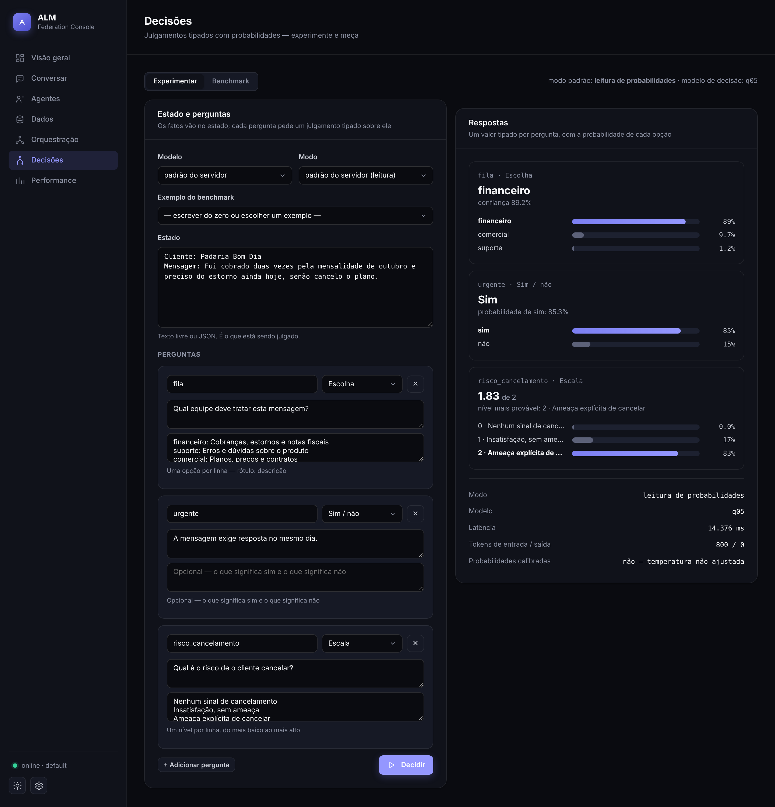
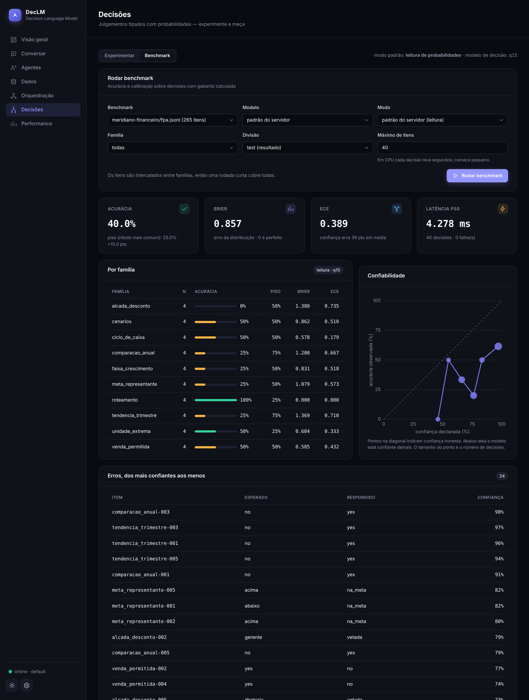

<h1 align="center">DecLM</h1>
<p align="center"><strong>Decision Language Model</strong></p>

<h3 align="center">Pare de pedir JSON a um LLM. Peça uma decisão.</h3>

<p align="center">
  <strong>Modelos de decisão</strong> de código aberto: perguntas tipadas entram — <em>qual? quanto? é verdade?</em> —<br>
  probabilidades saem. Uma passada, zero tokens gerados, no seu próprio hardware.
</p>

<p align="center">
  <a href="#-comece-em-60-segundos">Comece</a> •
  <a href="#-mesmo-modelo-mesmas-perguntas">Os números</a> •
  <a href="#-como-funciona">Como funciona</a> •
  <a href="#-um-benchmark-que-nenhum-modelo-corrigiu">Benchmark</a> •
  <a href="#-onde-estamos">Estado</a> •
  <a href="#-a-federação-em-volta">A federação</a>
</p>

<p align="center">
  <a href="README.md">Read in English</a>
</p>

<p align="center">
  
</p>

---

## O problema de pedir uma decisão a um chatbot

A maior parte do que um sistema de agentes pede a um modelo não é prosa. É uma **decisão que o
seu código consome**: qual fila, qual ferramenta, isto é permitido, quem aprova, qual a gravidade.
Hoje isso se parece com isto:

```python
resposta = llm("Classifique este chamado. Responda em JSON, com uma confiança de 0 a 1...")
dados = json.loads(resposta)     # funciona, na maioria das vezes
dados["confianca"]               # um número que o modelo inventou
```

Você paga cada token de saída, espera por eles um a um, e a confiança não significa nada.

O modelo já *sabia* a resposta antes de escrever o primeiro caractere — como uma probabilidade
sobre o próximo token. O DecLM lê a resposta ali:

```python
from alm.decision import Choice, DecisionEngine, DecisionRequest, Noul, Score

result = await engine.decide(DecisionRequest(
    state="Charged twice for October. Refund me today or I cancel my plan.",
    questions={
        "queue": Choice(instructions="Which team handles this?",
                        options={"billing": "charges and refunds",
                                 "support": "product issues",
                                 "sales": "plans and contracts"}),
        "cancel_threat": Noul(instructions="The customer is threatening to cancel."),
        "churn_risk": Score(instructions="How likely is the customer to cancel?",
                            levels=["no sign", "unhappy", "explicit threat"]),
    },
))

result.choice("queue").probabilities     # {'billing': 0.9999, 'support': 0.00003, 'sales': 0.00004}
result.noul("cancel_threat").probability # 0.9956
result.score("churn_risk").probabilities # [0.0, 0.0038, 0.9962]
result.completion_tokens                 # 0
```

Essa saída é real: Qwen2.5-1.5B, sem treino, numa CPU. Três perguntas, uma chamada, nenhum texto
gerado — e um número sobre o qual dá para pôr um limite: aprovar sozinho acima de 0,95, mandar o
resto para uma pessoa.

## 📊 Mesmo modelo, mesmas perguntas

Só mudou a forma de perguntar.

| | Pedir JSON | Ler a decisão |
|---|---|---|
| **Acurácia** | 48,6% | **63,9%** |
| **Tempo por decisão** | 10,2 s | **3,7 s** |
| **Tokens de saída** | pagos | **0** |
| **Probabilidade de cada opção** | não | **sim** |
| Perguntas de roteamento certas | 0 de 12 | 6 de 12 |

<sub>Qwen2.5-1.5B-Instruct, sem treino, 4 núcleos de CPU, os 72 itens públicos "original" do
<a href="https://github.com/fstandhartinger/jevbench">JevBench</a>, uma rodada cada. Sem a correção
do viés de ordem, a leitura cai para 1,4 s com 62,5%. É uma amostra pequena num modelo pequeno — o
ponto é que você pode <a href="#-um-benchmark-que-nenhum-modelo-corrigiu">rodar de novo</a> em minutos.</sub>

## ⚡ Comece em 60 segundos

Sem chave de API. Sem GPU para experimentar.

```bash
git clone https://github.com/ceschmiedel/ALM.git && cd ALM
pip install -e ".[local]"                # Python ≥ 3.11
declm init
declm model add decisor --tier slm --backend transformers --model Qwen/Qwen2.5-1.5B-Instruct
ALM_DECISION_BACKEND=readout ALM_DECISION_MODEL=decisor declm serve
```

<sub>Só CPU? Acrescente <code>--param device=cpu --param dtype=float32</code> à linha do <code>model add</code>.</sub>

Abra **http://localhost:8800/ui/#/decisions** e experimente — ou chame direto:

```bash
curl -s localhost:8800/v1/systemone -H 'content-type: application/json' -d '{
  "state": "Fui cobrado duas vezes em outubro. Estornem hoje ou cancelo o plano.",
  "questions": {
    "fila":      {"type": "choice", "instructions": "Qual equipe trata isto?",
                  "criteria": {"financeiro": "cobranças e estornos", "suporte": "erros do produto"}},
    "ameaca":    {"type": "noul",   "instructions": "O cliente ameaça cancelar."},
    "risco":     {"type": "score",  "instructions": "Qual o risco de o cliente cancelar?",
                  "criteria": ["nenhum sinal", "insatisfeito", "ameaça explícita"]}
  }
}'
```

`/v1/systemone` é o formato de requisição que os modelos de decisão hospedados já falam, então
SDKs e benchmarks escritos para ele podem apontar para o seu próprio servidor.

## 🧩 Três perguntas bastam

| Primitiva | Pergunta | Você recebe |
|---|---|---|
| **Choice** (escolha) | Qual opção? | O rótulo, e a probabilidade de cada opção |
| **Score** (escala) | Onde numa escala ordenada? | O nível esperado, e a probabilidade de cada nível |
| **Noul** (sim/não) | Isto é verdade? | A probabilidade de "sim" |

Roteamento, barreiras de segurança, alçadas de aprovação, regras de elegibilidade, triagem,
correção por rubrica, reordenação — tudo se decompõe nessas três. Várias perguntas sobre o mesmo
estado saem numa única chamada.

## 🔬 Como funciona

```
 estado + pergunta ──►  A. financeiro   B. suporte   C. comercial  ──►  uma passada
                                                                            │
                          P(próximo token = "A"), P("B"), P("C")  ◄─────────┘
                                          │
              mostrado em várias ordens, com média   →  o viés de posição se cancela
                                          │
                  temperatura por tipo de pergunta   →  probabilidades calibradas
```

- **Leitura.** As opções ficam atrás de rótulos de um token. O modelo roda uma vez e a
  probabilidade de cada rótulo é lida da distribuição do próximo token. Nada é gerado, então nada
  é interpretado.
- **Correção do viés de ordem.** Modelos pequenos preferem o que vem primeiro na lista. Cada
  escolha é mostrada em várias rotações e as log-probabilidades entram numa média, o que cancela
  um viés de posição aditivo no espaço dos logits. Num modelo de 0,5B, só isso levou a acurácia
  das escolhas de 33% para 47%.
- **Calibração que dá para medir.** Uma temperatura por tipo de pergunta, ajustada em dados
  rotulados, e um benchmark que reporta Brier e ECE ao lado da acurácia.
- **Um recuo que sempre funciona.** A um modelo que esconde os logits — Claude, GPT, qualquer um
  atrás de uma API só de chat — pede-se JSON, pelo mesmo contrato. Perde-se a distribuição, não a
  funcionalidade.

| Onde o modelo roda | Leitura | Observações |
|---|---|---|
| Em processo, `transformers` (qualquer modelo aberto, com adaptadores LoRA) | ✅ exata | O caminho usado em todos os números desta página |
| vLLM / servidor compatível com OpenAI com `logprobs` | ✅ 20 mais prováveis | Implementado; testado só contra respostas simuladas |
| Hugging Face Inference Providers | só JSON | 13 pares de modelo Qwen e provedor sondados: nenhum devolveu `logprobs` |
| Claude, Gemini, Ollama | só JSON | As APIs não expõem probabilidades de token |

## 🏁 Um benchmark que nenhum modelo corrigiu

A maioria dos benchmarks de decisão é rotulada por um modelo maior, então a nota mede concordância
com esse modelo. Este vem no repositório e cada resposta esperada é **calculada a partir de uma
planilha**: 265 decisões em português do Brasil sobre um modelo financeiro de três demonstrações —
alçadas de aprovação, política de desconto, faixas de crescimento, atingimento de meta, ciclo de
caixa, roteamento. As famílias são balanceadas, então responder sempre o rótulo mais comum rende 20%.

```bash
declm decide bench packs/meridiano-financeiro/decisions/fpa.jsonl --split test --model decisor --backend readout
```

| Modelo, sem treino | Onde roda | Modo | Acurácia | Brier | ECE |
|---|---|---|---|---|---|
| Qwen2.5 0,5B | CPU de 4 núcleos | leitura | 42,3% | 0,706 | 0,163 |
| Qwen2.5 1,5B | CPU de 4 núcleos | leitura | 46,9% | 0,756 | 0,334 |
| Qwen3.5 9B | Hugging Face | JSON | 76,3% | — | — |
| Qwen2.5 72B | Hugging Face | JSON | **83,5%** | — | — |

<sub>Divisão de teste, 194 itens, uma rodada por modelo. Números por família e ressalvas:
<a href="packs/meridiano-financeiro/README.md#benchmark-de-decisões">README do pack</a>.</sub>

Três coisas que essa tabela diz em voz alta:

1. **Modelos pequenos sem treino roteiam, mas não calculam.** Abaixo de 2B, tudo o que tem regra
   numérica fica no acaso. Essa é a distância que um modelo de decisão treinado precisa fechar.
2. **Uma família derrota todos os modelos, inclusive o de 72B.** Ciclo de caixa — somar dois
   números, subtrair um terceiro, comparar — fica em 47% em todos, abaixo do próprio piso de 53%.
   Decida no modelo, calcule no código.
3. **Modelos hospedados não podem ser calibrados.** Sem probabilidades, não há Brier nem ECE.

**Supere a linha de base.** Rode no seu modelo e abra um PR com os números.

<p align="center">
  
</p>

## 🚦 Onde estamos

Estado honesto, porque um README não é um benchmark.

| | |
|---|---|
| ✅ | Contrato de decisão — Choice, Score, Noul — com os modos de leitura e de JSON |
| ✅ | `POST /v1/systemone`, correção do viés de ordem, temperatura por tipo |
| ✅ | `declm decide bench` — acurácia, Brier, ECE, curva de confiabilidade |
| ✅ | Um benchmark em português com gabarito calculado |
| ✅ | `declm decide dataset build` — dados de treino de fontes públicas com licença classificada e geradores por regra, **sem rótulo vindo de modelo** |
| ✅ | Uma tela no painel para experimentar decisões e rodar benchmarks |
| 🚧 | **O adaptador de decisão treinado.** Tudo acima roda sobre modelos abertos *sem treino*. Um LoRA sobre um modelo pequeno, treinado com esses dados e julgado pelo benchmark, é o próximo passo — precisa de GPU, e ajuda é bem-vinda |
| 🗺️ | Cache de prefixo, para várias perguntas compartilharem uma passada sobre o estado |

Se você tem uma GPU e quer treinar o primeiro modelo de decisão aberto em português, os dados, o
benchmark e o caminho de serving já estão aqui. Veja [docs/decisions.md](docs/decisions.md).

<sub>A técnica de leitura segue os projetos abertos de modelos de decisão, em especial
<a href="https://github.com/nokia-applied-research/AnyJev">AnyJev</a> e
<a href="https://github.com/jaredpalmer/kev">Kev</a> (ambos Apache-2.0); a implementação é do
próprio DecLM. O DecLM não é afiliado a nenhum fornecedor de modelo de decisão hospedado.</sub>

---

# 🌐 A federação em volta

A decisão é a menor unidade. O DecLM é também o sistema que roda sobre ela: uma federação governada de especialistas de domínio, cada um com o seu modelo pequeno,
orquestrada por um Context Graph. O roteador, o árbitro, os corretores e a política de acesso são
todos decisões tipadas, e é por isso que o modelo de decisão existe.

## 🧭 Por que uma federação

A arquitetura de agentes hoje dominante coloca um único LLM de fronteira no centro: todos os agentes
chamam o mesmo modelo, variando apenas o prompt. Funciona, e encosta em quatro limites estruturais
no cliente enterprise em vertical regulada — custo agregado de token, latência e dependência
externa, soberania de dados, e comportamento genérico que nunca internaliza a ontologia do cliente.

**A tese do DecLM:** num domínio, uma federação de especialistas bem roteada supera o generalista —
mas essa superioridade **não é automática**. Ela depende quase inteiramente da qualidade das camadas
de contexto e roteamento, não dos modelos individuais. Por isso este projeto investe onde está a
alavanca:

| Os modelos | A orquestração |
|---|---|
| Substituíveis | Onde o valor se acumula |
| Um adaptador LoRA, um SLM, uma API | O Context Graph que os roteia, a memória que os conecta, a governança que os torna auditáveis |

O DecLM não nega o LLM. Ele o reposiciona: de executor onipresente para orquestrador eventual e
professor dos modelos de domínio. Onde soberania, latência e volume pesam, o especialista local
assume; onde o raciocínio aberto é essencial, o LLM continua no circuito.

**O fallback para o LLM é projeto, não fracasso.** Ele garante que a federação nunca fique pior que
o baseline monolítico: no pior caso, ela devolve a tarefa ao LLM. No caso comum, ela resolve local,
barato e dentro do perímetro do cliente.

---

## 🏗️ Arquitetura

Cinco camadas funcionais e duas transversais. Cada uma mapeia para um pacote Python.

```
                    ┌──────────────────────────────────────────┐
   intenção ──────► │ L1  Interface e ingestão      alm.protocol
                    │     Liquid Interface Protocol (LIP)      │
                    └───────────────────┬──────────────────────┘
                                        ▼
                    ┌──────────────────────────────────────────┐
                    │ L2  Roteador cognitivo         alm.router │
                    │     classifica · decompõe · casa · confia │
                    └───────────────────┬──────────────────────┘
                                        ▼
                    ┌──────────────────────────────────────────┐
                    │ L4  Orquestração de dependências  alm.orchestration
                    │     plano ──► DAG · paralelo quando independente
                    └───────────────────┬──────────────────────┘
                                        ▼
                    ┌──────────────────────────────────────────┐
                    │ L3  Federação de experts        alm.experts
                    │     modelo próprio (DecLM) + recuperação própria (CMRAG)
                    └───────────────────┬──────────────────────┘
                                        ▼
                    ┌──────────────────────────────────────────┐
                    │ L5  Arbitragem e síntese     alm.arbitration
                    │     verificador · confiança · autoridade · juiz
                    └───────────────────┬──────────────────────┘
                                        ▼
                              resposta + trilha completa

   CX  Contexto e memória  alm.graph + alm.cmrag  ── alimenta roteamento, execução, síntese
   GV  Governança (IBAC)   alm.governance         ── nenhum acesso a contexto ocorre fora dela
```

### O que é realmente novo aqui

Mixture-of-Experts não é novidade; a diferença está em **onde vive o roteamento**. Dentro de um LLM
com MoE o roteador é interno, implícito, aprendido e não auditável. No DecLM o roteamento é **externo,
explícito e governável**: o Context Graph decide qual expert é ativado, em que ordem e como os
resultados são combinados — e registra por quê.

Isso torna explícito o que o monolito faz implicitamente. É ao mesmo tempo o maior custo de
engenharia da federação e a sua maior vantagem: um monolito não consegue mostrar como decidiu; uma
federação, sim. Em setores onde auditabilidade é obrigatória, isso deixa de ser diferencial e vira
pré-requisito.

---

## 🚀 Início rápido

### Instalação

Requer **Python ≥ 3.11** e **pip ≥ 21.3**. Nenhum dos dois pisos é firula, e as ferramentas padrão
do Mac não atendem a nenhum deles:

- **Python 3.11** — o código usa `StrEnum`, que não existe antes do 3.11. O macOS traz o Python 3.9
  e o `python3 -m venv` o pega silenciosamente, resultando em
  `requires a different Python: 3.9.6 not in '>=3.11'`.
- **pip 21.3** — este projeto tem apenas `pyproject.toml`, e instalação editável de um projeto sem
  `setup.py` depende da PEP 660. Um pip mais antigo falha com
  `File "setup.py" or "setup.cfg" not found`.

Então nomeie a versão do interpretador explicitamente em vez de confiar no `python3`:

```bash
git clone https://github.com/ceschmiedel/ALM.git
cd ALM

python3.12 -m venv venv           # macOS: instale antes com brew install python@3.12
source venv/bin/activate          # Windows: py -3.12 -m venv venv && venv\Scripts\activate

python -m pip install --upgrade pip
pip install -e ".[dev]"
```

Confira com `python --version` depois de ativar. Um `pip install .` simples funciona também em pip
antigo, se você não precisa de instalação editável.

<details>
<summary><strong>Problemas na instalação</strong> — os três erros que um macOS de fábrica produz</summary>

<br>

**`Package 'declm' requires a different Python: 3.9.6 not in '>=3.11'`**

O venv foi criado com o `python3` da Apple (3.9). Apague e nomeie a versão explicitamente:

```bash
rm -rf venv && python3.12 -m venv venv && source venv/bin/activate
```

**`File "setup.py" or "setup.cfg" not found. Directory cannot be installed in editable mode`**

O pip é anterior à 21.3 e não conhece a PEP 660. Atualize dentro do venv já ativado:

```bash
python -m pip install --upgrade pip
```

**`Command '[...venv/bin/python3', '-Im', 'ensurepip', ...]' returned non-zero exit status 1`**

O `python -m venv` apontou para um diretório que já continha um venv de outro interpretador; ele
tenta atualizar no lugar e falha. Remova em vez de reaproveitar:

```bash
rm -rf venv && python3.12 -m venv venv
```

Se ainda falhar num diretório limpo, instale o pip à parte:

```bash
python3.12 -m venv --without-pip venv && source venv/bin/activate
curl -sS https://bootstrap.pypa.io/get-pip.py | python
```

</details>

### Rode a demo — sem API key, sem GPU

```bash
declm init
declm pack install packs/demo-enterprise
declm ask "Qual é nossa exposição financeira máxima sob o teto de responsabilidade da cláusula 7.2, e qual risco residual permanece?" --trace
```

Você recebe a resposta, o plano que a produziu, qual expert contribuiu com o quê, como o conflito
entre os experts jurídico e financeiro foi arbitrado, e o custo e a latência de cada chamada.

> ⚠️ O pack demo usa o backend `heuristic` — um respondedor **extrativo determinístico**, não um
> modelo de linguagem. Ele existe para que roteamento, recuperação, DAG, arbitragem, governança e
> avaliação sejam todos exercitados de verdade sem nenhuma dependência externa. Aponte para
> `ollama` ou `vllm` para rodar com modelos reais.

### Conecte modelos reais

```bash
declm install                   # assistente interativo, escreve o .env
declm model add router      --tier micro_slm    --backend ollama --model qwen2.5:0.5b
declm model add finance-slm --tier slm          --backend ollama --model qwen2.5:3b
declm model add orquestrador --tier orchestrator --backend openai --model gpt-4o
```

Serving multi-adaptador — muitos experts, uma base carregada, uma GPU:

```bash
declm model add legal-expert --tier slm --backend vllm \
  --base-model meta-llama/Llama-3.2-3B-Instruct --adapter legal-lora-v3
declm model list        # mostra bases compartilhadas, adaptadores e cargas evitadas
```

**Prefere uma interface visual?** `declm serve` sobe a API em `http://localhost:8800` e
monta um painel web em **`/ui`** — sem etapa de build, sem fontes externas, roda
offline como o resto do stack. Seis telas:

- **Conversar** — pergunte em linguagem natural. Você não escolhe o agente: o roteador
  classifica, aciona os especialistas que declararam capacidade sobre aquilo e escala
  para o orchestrator quando nenhum tem confiança suficiente. Cada resposta mostra
  quais agentes contribuíram, a confiança, as fontes citadas e a trilha de decisão
  camada a camada.
- **Agentes** — crie um Expert Agent sem escrever um pack: nome, domínio, modelo
  escolhido num dropdown e as capacidades contra as quais o roteador compara a
  pergunta. Editar reatribui o modelo no lugar; excluir também remove os nós de
  capacidade, para o roteador parar de casar com um especialista que não existe mais.
- **Dados** — arraste um `.csv`, `.tsv` ou `.xlsx` e ele é indexado no corpus de um
  domínio. Tabela **não** é fatiada como prosa: cada trecho repete o nome da aba e a
  lista de colunas, e toda aba ganha um documento de esquema descrevendo colunas e
  faixas numéricas. É isso que faz uma planilha responder perguntas em vez de virar ruído.
- **Orquestração** — veja tudo que seu daemon Ollama já baixou (e o que está carregado
  em memória), atribua a uma camada por dropdown, e registre um **fallback hospedado**
  grande (OpenAI, Anthropic, Gemini ou qualquer endpoint compatível com OpenAI) via
  API token — com botão *Testar* que dispara uma chamada real, para uma chave errada
  falhar ali e não na primeira escalação.
- **Decisões** — monte um estado e perguntas tipadas (escolha, escala, sim/não) e veja a
  resposta com a probabilidade de cada opção; rode o benchmark de decisões de um pack e
  acompanhe acurácia, Brier, ECE e a curva de confiabilidade por família.
- **Performance** — rode avaliações da federação contra a baseline monolítica, com
  comparação das seis métricas e histórico completo por caso.

---

## 🎯 Escolhendo o modelo de cada agente

Não comece treinando modelos. A pergunta certa nunca é "qual modelo treinar", e sim **"este agente
precisa mesmo de um modelo próprio, ou basta recuperação de contexto sobre um modelo
compartilhado?"**

| Tier | Porte | Usar para |
|---|---|---|
| `micro_slm` | < 1B | Classificação, extração, roteamento, normalização. CPU basta. |
| `slm` | 1–4B | O especialista de domínio padrão. Uma GPU. |
| `small` | 4–8B | Raciocínio mais longo, ainda viável on-premise. |
| `orchestrator` | fronteira | Planejamento, casos ambíguos, arbitragem difícil, geração de dados de treino. Com parcimônia. |

E suba de degrau só quando o anterior não resolver — medido, não intuído:

| Técnica | Esforço | Resolve |
|---|---|---|
| RAG sobre modelo compartilhado | Baixo | Conhecimento factual que muda com frequência. **Primeira escolha sempre.** |
| Adaptador LoRA | Médio | Formato, tom, vocabulário, padrões de raciocínio. Barato de treinar **e de servir**. |
| Fine-tuning completo (SFT) | Médio-alto | Especialização profunda quando o adaptador não basta. |
| Continued pretraining | Alto | Domínios cuja linguagem o modelo base desconhece. |

```bash
declm expert promote-check finance-expert --sovereignty --calls 120000
```

avalia os quatro gatilhos de negócio — soberania, volume, latência, acurácia — contra dados reais.
**A maioria dos agentes para no LoRA.**

---

## 📊 Avaliação

> A tese do DecLM é falsificável e é tratada assim. Sem harness de avaliação, o DecLM é fé; com ele, é
> engenharia.

O harness roda a mesma bateria em duas configurações — **(a)** o LLM monolítico com bom prompt e
RAG, e **(b)** a federação — e compara no **conjunto** das dimensões, não em uma métrica só:

```bash
declm eval run --pack packs/demo-enterprise --compare
```

| Métrica | O que revela |
|---|---|
| Acurácia de domínio | Qualidade na tarefa real. A métrica soberana. |
| Custo por consulta | Custo total de infraestrutura, não só preço de token. |
| Latência p95 | É a cauda que o cliente sente, não a média. |
| Taxa de fallback | Cobertura dos especialistas. Reportada, não pontuada. |
| Consistência | Variação de comportamento — risco específico da federação. |
| Auditabilidade | Completude da trilha. Onde a federação vence por construção. |

**No pack demo, a federação perde em acurácia — e isso está correto.** Ambos os braços rodam no
backend extrativo, o que remove exatamente aquilo que a federação compra (raciocínio de domínio por
um modelo especializado) mantendo todo o seu overhead. O que sobressai é estrutural:
**auditabilidade 1,00 contra 0,00**.

Se a federação não vencer no conjunto, a decisão honesta é manter aquele agente como RAG sobre o
modelo compartilhado. **O DecLM se aplica onde vence, não em todo lugar por princípio** — e o
`declm eval run` diz isso explicitamente em vez de deixar você ler o número que preferir.

---

## 🔐 Governança e soberania

Onde o DecLM realmente brilha não é no custo, é na soberania. Com os experts e seus modelos rodando
on-premise ou na VPC do cliente, os dados sensíveis não saem do ambiente — o que transforma
exigências de NIS2, EU AI Act e LGPD de obstáculo em recurso de arquitetura.

O IBAC governa cada **agente**, não só cada usuário: um expert de um domínio não enxerga dados de
outro sem autorização explícita, e todo acesso é registrado.

```bash
declm audit tail --session ses_a1b2c3
declm audit export > audit.jsonl
```

---

## 🔄 Destilação

O gargalo real do DecLM não é treinar, é ter dados de domínio de qualidade.

```bash
declm distill seed     --domain legal    # 1 · semear com o corpus real
declm distill generate --domain legal    # 2 · gerar com o professor
declm distill filter   --domain legal    # 3 · filtrar e validar
declm distill export   --domain legal --out .alm/datasets/legal.jsonl
declm distill feedback --domain legal    # 5 · falhas de produção de volta ao ciclo
```

Dados ruins ensinam erros de forma persistente, então a etapa de filtro não é opcional, e o conjunto
de avaliação nunca é visto no treino. A etapa 5 é onde a federação **melhora com o uso**: cada caso
em que um expert falhou ou escalou é capturado e realimentado.

---

## ⚠️ Limites conhecidos

Uma arquitetura honesta declara onde pode falhar.

| Risco | Mitigação neste repositório |
|---|---|
| **Carga de MLOps** | Serving multi-adaptador (menos artefatos), versionamento com promoção travada por avaliação e detecção de drift desde o primeiro agente |
| **Fragmentação de conhecimento** | Memória e roteamento centralizados no Context Graph: os modelos executam, o grafo integra |
| **Inconsistência entre agentes** | Base compartilhada, guidelines comuns e a camada L5 uniformizando a saída |
| **Modelo pequeno derrapando** | Fallback projetado para o orquestrador: a federação nunca fica pior que o baseline |
| **Curva de preço do LLM caindo** | A proposta de valor está ancorada em soberania, latência, auditabilidade e defensibilidade — que não caem com o preço do token |

O DecLM não é a arquitetura padrão para tudo. É uma camada premium para verticais reguladas e de alto
volume, adotada de forma híbrida e incremental.

---

## 📚 Documentação

| Documento | Conteúdo |
|---|---|
| [docs/architecture.md](docs/architecture.md) | A arquitetura em camadas em profundidade |
| [docs/domain-packs.md](docs/domain-packs.md) | Schema dos packs e guia de autoria |
| [docs/routing.md](docs/routing.md) | Decomposição, casamento, confiança, fallback |
| [docs/arbitration.md](docs/arbitration.md) | Estratégias de resolução de conflito e síntese |
| [docs/decisions.md](docs/decisions.md) | Decisões tipadas: Choice, Score e Noul atrás de um contrato |
| [docs/serving.md](docs/serving.md) | Tiers, backends e serving multi-adaptador LoRA |
| [docs/evaluation.md](docs/evaluation.md) | O experimento de controle e suas métricas |
| [docs/distillation.md](docs/distillation.md) | Pipeline professor→aluno e o ciclo de realimentação |
| [docs/governance.md](docs/governance.md) | IBAC, soberania e a trilha de auditoria |
| [docs/deployment.md](docs/deployment.md) | Docker, PostgreSQL, vLLM, on-premise |
| [docs/adoption.md](docs/adoption.md) | O caminho de adoção em três ondas |

---

## 📖 Fundamentação

- **SLMs por agente são viáveis e preferíveis** — Belcak et al. (2025), [arXiv:2506.02153](https://arxiv.org/abs/2506.02153)
- **A inteligência migra para o sistema, não o modelo** — Zaharia et al. (2024), BAIR; Jain et al. (2024), [arXiv:2412.01868](https://arxiv.org/abs/2412.01868)
- **A soma de especialistas pode superar o generalista** — Jacobs et al. (1991); Shazeer et al. (2017), [arXiv:1701.06538](https://arxiv.org/abs/1701.06538); Jiang et al. (2023), *LLM-Blender*
- **Roteamento com fallback reduz custo** — Chen, Zaharia & Zou (2023), *FrugalGPT*, [arXiv:2305.05176](https://arxiv.org/abs/2305.05176)
- **Como construir os modelos de domínio** — Lewis et al. (2020), *RAG*; Hu et al. (2021), *LoRA*; Hinton et al. (2015), *Distillation*; Gururangan et al. (2020)
- **Decisões lidas do modelo, sem viés de ordem e calibradas** — Zheng et al. (2024), *Large Language Models Are Not Robust Multiple Choice Selectors*, ICLR; Guo et al. (2017), [arXiv:1706.04599](https://arxiv.org/abs/1706.04599). A técnica de leitura segue os projetos abertos de modelos de decisão, em especial [AnyJev](https://github.com/nokia-applied-research/AnyJev) e [Kev](https://github.com/jaredpalmer/kev) (ambos Apache-2.0); a implementação é do próprio DecLM.
- **A economia do serving** — Sheng et al. (2023), *S-LoRA*, [arXiv:2311.03285](https://arxiv.org/abs/2311.03285)

---

## 📄 Licença

MIT — veja [LICENSE](LICENSE).

<p align="center">Feito com ❤️ por <a href="https://github.com/ceschmiedel">Carlos Schmiedel</a></p>
